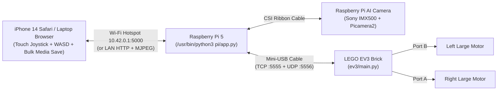

# Drone Boat Technical & Setup Documentation

Complete guide explaining **how the Drone Boat system works** and **exact step-by-step instructions and commands** to set up and run it on a **LEGO MINDSTORMS EV3 Brick**, **Raspberry Pi 5**, **Raspberry Pi AI Camera (IMX500)**, and **iPhone 14**.

---

## 1. System Overview & Hardware Architecture

The Drone Boat uses a two-computer onboard architecture paired with a wireless mobile/desktop cockpit:

- **iPhone 14 (Safari) / Laptop Browser**: Displays the live camera HUD, sends steering, photo, video, and AI commands over Wi-Fi, and supports multi-select bulk saving of photos and videos directly to the iPhone Photos app or as a single ZIP archive.
- **Raspberry Pi 5 (`pi/`)**: Hosts the HTTP web server (`pi/app.py`), captures live video and on-chip AI inference from the **Raspberry Pi AI Camera (IMX500)**, records photos/videos locally, and forwards motor commands to the EV3 over a wired USB cable.
- **LEGO EV3 Brick (`ev3/main.py`)**: Runs Pybricks MicroPython on ev3dev Linux, drives the two Large Motors (**Port A = Right motor**, **Port B = Left motor**) with automatic hot-plug detection, listens on both IPv4 and IPv6 TCP port `5555` + UDP discovery port `5556`, and acts as an independent safety watchdog.



### Project File Layout

```text
drone_boat/
├── DOCUMENTATION.md          # Complete technical & step-by-step setup guide
├── README.md                 # Quick-start summary
├── .gitattributes            # Enforces LF line endings on Python scripts for EV3 Linux
├── .gitignore
├── ev3/
│   └── main.py               # Pybricks MicroPython TCP (IPv4/IPv6) + UDP discovery motor server
└── pi/
    ├── requirements.txt      # Raspberry Pi OS apt package reference
    ├── config.py             # Environment-configurable ports, speed, camera & AI settings
    ├── ev3_bridge.py         # Differential tank mixer, USB/ARP/UDP discovery, TCP client & watchdog
    ├── camera_manager.py     # Picamera2 + IMX500 AI detection, MJPEG stream, photo & MP4 video capture
    ├── app.py                # Stdlib ThreadingHTTPServer, control API, HTTP 206 media & batch ZIP server
    ├── media/                # Created automatically at runtime (photos/*.jpg, videos/*.mp4)
    └── static/
        ├── index.html        # Full-screen iPhone 14 cockpit layout & multi-select gallery drawer
        ├── style.css         # Glassmorphic HUD, safe-area insets & batch selection styles
        └── controller.js     # Pointer joystick, WASD keyboard, multi-select iOS share & ZIP download
```

---

## 2. Detailed Step-by-Step Setup & Commands

### Phase 1: Hardware Wiring
1. **EV3 Motors**:
   - Plug the **Right Large Motor** into **Port A** on the EV3 Brick.
   - Plug the **Left Large Motor** into **Port B** on the EV3 Brick.
   - *(Note: `ev3/main.py` supports motor hot-plugging—if a motor cable is plugged in after the program starts, it will automatically initialize on the next joystick move.)*
2. **Raspberry Pi AI Camera**:
   - With the Raspberry Pi 5 powered **off**, insert the AI Camera CSI ribbon cable into one of the Pi 5 `CAM/DISP` ports and lock the plastic clip.
3. **USB Link (Pi 5 <-> EV3)**:
   - After uploading `ev3/main.py` to the EV3 (Phase 2 below), connect the EV3 mini-USB port (top of brick) directly to any **USB-A port on the Raspberry Pi 5**.
4. **Power Supplies**:
   - Power the **Raspberry Pi 5** from a dedicated 5V/5A USB-C power bank.
   - Power the **LEGO EV3 Brick** from its own EV3 battery pack or 6x AA batteries.

---

### Phase 2: Upload & Run `ev3/main.py` on the EV3 Brick

1. Turn on your EV3 Brick and plug its mini-USB cable into your laptop.
2. Verify your laptop can reach the EV3:
   ```powershell
   ping -n 2 ev3dev.local
   ```
3. Upload `ev3/main.py` to the EV3 using **either** VS Code or `scp`:

   #### Method A: VS Code EV3DEV Device Browser
   1. Look at the bottom of the left Explorer sidebar under **EV3DEV DEVICE BROWSER**.
   2. Click **"Click here to connect to a device"** and choose **`ev3dev`**.
   3. Once connected (green dot), press **`F5`** (or click the **Send workspace to device** upload icon).

   #### Method B: Command Line (`scp` from Laptop or Pi)
   ```powershell
   ssh robot@ev3dev.local "mkdir -p /home/robot/drone_boat/ev3"
   scp ev3/main.py robot@ev3dev.local:/home/robot/drone_boat/ev3/main.py
   ```
   *(When prompted for the password, type `maker` and press Enter.)*

4. Ensure `main.py` has executable permissions on the EV3 (only needed once if uploaded via `scp`):
   ```powershell
   ssh robot@ev3dev.local "chmod +x /home/robot/drone_boat/ev3/main.py"
   ```
5. Unplug the USB cable from your laptop and **plug the EV3 into the Raspberry Pi 5 USB-A port**.
6. On the EV3 Brick screen:
   - Open **File Browser** → navigate into **`drone_boat/ev3`** (or **`ev3_project`**) → select **`main.py`** → press the **Center button**.
   - The EV3 will **beep once** and display:
     ```text
     Boat EV3 Ready
     169.254.x.x
     Port: 5555
     ```
   - *(If a motor is not plugged into Port A or B yet, it will also display `No Motor: A,B` and automatically activate the motor as soon as you plug it in.)*

---

### Phase 3: Install Packages & Code on the Raspberry Pi 5

1. Open a terminal on your **Raspberry Pi 5** and install the required system packages via `apt`:
   ```bash
   sudo apt update
   sudo apt install -y python3-picamera2 python3-opencv imx500-all ffmpeg git
   sudo reboot
   ```
2. After rebooting, confirm that Raspberry Pi OS detects the IMX500 AI Camera:
   ```bash
   rpicam-hello --list-cameras
   ```
   - You must see `imx500` listed.
   - Test that system Python can import `picamera2`:
     ```bash
     /usr/bin/python3 -c "from picamera2 import Picamera2; print('Picamera2 OK')"
     ```
3. Clone or update the project on the Raspberry Pi 5:
   ```bash
   cd ~
   git clone https://github.com/ridzuanazam/drone_boat.git
   ```
   *(If already cloned, update with `cd ~/drone_boat && git pull`.)*

---

### Phase 4: Configure Raspberry Pi 5 Wi-Fi Hotspot (For iPhone Control)

When testing outdoors or anywhere without a local router, turn the Raspberry Pi 5 into a Wi-Fi Hotspot so your iPhone connects directly to the Pi:

1. **Start the Hotspot on the Raspberry Pi 5:**
   ```bash
   sudo nmcli device wifi hotspot ifname wlan0 ssid DroneBoat password "droneboat"
   ```
   - On this hotspot, the Raspberry Pi 5's IP address is always **`10.42.0.1`**.
2. **(Optional) Make the Hotspot auto-start every time the Pi boots:**
   ```bash
   sudo nmcli connection modify Hotspot connection.autoconnect yes
   ```
3. **How to switch back to normal home Wi-Fi later:**
   ```bash
   sudo nmcli connection down Hotspot
   sudo nmcli device wifi connect "YOUR_HOME_WIFI_SSID" password "YOUR_HOME_WIFI_PASSWORD"
   ```

---

### Phase 5: Start the Raspberry Pi Server & Connect iPhone 14

1. Confirm the EV3 is plugged into the Raspberry Pi 5 via USB and showing **`Boat EV3 Ready / Port: 5555`**.
2. On the Raspberry Pi 5 terminal, start the server using **system Python** (`/usr/bin/python3`):
   ```bash
   cd ~/drone_boat/pi
   /usr/bin/python3 app.py
   ```
   > **Important:** Always use `/usr/bin/python3 app.py` (do **not** use an isolated `venv`, because `python3-picamera2` and `imx500` are installed in `/usr/lib/python3/dist-packages`).
3. Within 1–2 seconds, check the EV3 screen—it will say **`Pi Connected`**.
4. On your **iPhone 14**:
   - Open **Settings → Wi-Fi** and connect to **`DroneBoat`** (password: `droneboat`).
   - If iOS displays *"Wi-Fi Network 'DroneBoat' Does Not Appear to Be Connected to the Internet"*, tap **Keep Trying Wi-Fi** (or **Use Without Internet**).
   - Open **Safari** and go to:
     ```text
     http://10.42.0.1:5000
     ```
     *(Or `http://<pi-lan-ip>:5000` if using home Wi-Fi instead of the hotspot.)*
   - Tap **Share → Add to Home Screen** for a full-screen cockpit experience.

---

## 3. Saving & Downloading All Photos and Videos on iPhone

1. While driving, tap the **White Shutter button** to take JPEG photos or the **Red REC button** to record H.264 `.mp4` videos.
2. Tap the **`Gallery`** button at the top-right of your iPhone screen.
3. To save or download everything at once:
   - Tap **`Select All`** at the top-right of the gallery header (or tap **`Select`** and tap individual photos/videos to check them).
   - Choose one of the batch actions in the blue bar:
     - **`Save to iPhone`**: Opens the native iOS Share Sheet with all selected photos and videos pre-loaded. Tap **"Save X Images"** (or **"Save to Files"**) to save all of them directly into your iPhone **Photos** app in one tap!
     - **`Download ZIP`**: Packages all selected photos and videos into a single `drone_boat_media_YYYYMMDD_HHMMSS.zip` archive and downloads it to your iPhone.
     - **`Delete`**: Deletes all selected photos and videos from the Raspberry Pi SD card at once.

---

## 4. How the System Works Under the Hood

### 4.1 Differential Tank Steering (`pi/ev3_bridge.py` & `ev3/main.py`)
Both the iPhone touch joystick and keyboard `W`/`A`/`S`/`D` keys produce normalized steering coordinates `(x, y)`:
- `x` in `[-1.0, +1.0]`: turn left (`-1`) to turn right (`+1`)
- `y` in `[-1.0, +1.0]`: reverse (`-1`) to forward (`+1`)

1. **`mix_joystick(x, y, max_speed=900, deadzone=0.08)`**:
   - Applies a `0.08` radial deadzone so resting finger jitter never moves the motors.
   - Computes differential thrust (`raw_left = y + x`, `raw_right = y - x`), normalizes by `max(1.0, abs(raw_left), abs(raw_right))`, and scales to `MAX_SPEED` (`900` deg/s):
     - Full forward (`x=0, y=1`) -> `(+900, +900)`
     - Full reverse (`x=0, y=-1`) -> `(-900, -900)`
     - Spin right (`x=1, y=0`) -> `(+900, -900)`
     - Spin left (`x=-1, y=0`) -> `(-900, +900)`
2. **`EV3Bridge.set_motors(left, right)`** sends `M <left> <right>\n` (or `S\n` when `(0, 0)`) over a low-latency `TCP_NODELAY` socket to the EV3.
3. **`MotorController` in `ev3/main.py`** maps **`Port.B`** to `left_motor` and **`Port.A`** to `right_motor`, hot-reconnecting any motor port if a cable was plugged in after startup.

### 4.2 Automatic USB Link Discovery (IPv4 + IPv6 + ARP + UDP)
Plugging the EV3 into a Raspberry Pi 5 USB-A port creates a wired USB-Ethernet network interface (`169.254.x.x` link-local IPv4 and `fe80::...` link-local IPv6).
- `ev3/main.py` binds both IPv4 (`0.0.0.0:5555`) and IPv6 (`[::]:5555`) TCP sockets plus UDP discovery port `5556`.
- `pi/ev3_bridge.py` automatically checks `ev3dev.local` (IPv4 & IPv6), scans `/proc/net/arp` and `/proc/net/fib_trie` for `169.254.x.x` USB neighbors, and broadcasts `EV3_BOAT_DISCOVER` on UDP port `5556` across all interfaces so the Pi finds the EV3 even when `wlan0` is acting as a Wi-Fi Hotspot (`10.42.0.1`).

### 4.3 Three-Layer Runaway Safety Failsafe
1. **iPhone/Browser Layer (`controller.js`)**: Immediately sends `POST /api/stop` when you release the joystick, switch tabs, lock your iPhone, or open the gallery. Sends `POST /api/heartbeat` every `400 ms` while driving.
2. **Raspberry Pi 5 Layer (`ev3_bridge.py`)**: Stops the motors (`S\n`) if no command or heartbeat arrives from the iPhone within `1.2 s` (`COMMAND_TIMEOUT_S`).
3. **EV3 Layer (`ev3/main.py`)**: Immediately brakes both Port A and Port B motors if the Raspberry Pi stops sending heartbeats for `2.0 s` (`HEARTBEAT_TIMEOUT_MS`).

---

## 5. HTTP API Reference (`pi/app.py`)

| Method & Path | Purpose |
| :--- | :--- |
| `GET /` | Serves `pi/static/index.html` |
| `GET /static/<file>` | Serves `style.css`, `controller.js` |
| `GET /video_feed` | Multipart MJPEG live camera stream (`multipart/x-mixed-replace`) |
| `GET /api/status` | Returns EV3 connection status, motor speeds, camera readiness/errors, AI state, recording timer, and media count |
| `POST /api/drive` | Accepts `{"x": float, "y": float}` or `{"left": int, "right": int}` |
| `POST /api/stop` | Immediately brakes both EV3 motors |
| `POST /api/heartbeat` | Refreshes Pi-side `1.2 s` watchdog timer |
| `POST /api/ai` | Sets `{"enabled": bool}` or toggles AI overlay |
| `POST /api/photo` | Saves JPEG snapshot and returns item metadata (`201`) |
| `POST /api/video/start` | Starts recording H.264 `.mp4` video alongside live stream |
| `POST /api/video/stop` | Finalizes and saves video, returning item metadata |
| `GET /api/media` | Lists saved photos and videos newest-first |
| `GET /media/<photos\|videos>/<name>` | Serves media with HTTP `Range` (`206 Partial Content`); append `?download=1` for attachment download |
| `POST /api/media/batch-zip` | Streams a `.zip` archive of selected `{"items": [{"kind", "filename"}, ...]}` |
| `POST /api/media/batch-delete` | Deletes multiple selected media items at once |
| `DELETE /api/media/<photos\|videos>/<name>` | Deletes a single saved photo or video |

---

## 6. Auto-Start on Raspberry Pi 5 Boot (`systemd`)

To make the Drone Boat server start automatically whenever the Raspberry Pi 5 powers on, create `/etc/systemd/system/drone-boat.service`:

```bash
sudo tee /etc/systemd/system/drone-boat.service > /dev/null << 'EOF'
[Unit]
Description=Drone Boat Cockpit Server
After=network-online.target
Wants=network-online.target

[Service]
Type=simple
User=pi
WorkingDirectory=/home/pi/drone_boat/pi
ExecStart=/usr/bin/python3 /home/pi/drone_boat/pi/app.py
Restart=always
RestartSec=3

[Install]
WantedBy=multi-user.target
EOF
```

*(If your Raspberry Pi username is not `pi`, replace `User=pi` and `/home/pi` with your username, e.g. `$USER`.)*

Enable and start the service:
```bash
sudo systemctl daemon-reload
sudo systemctl enable --now drone-boat
```

Check logs at any time with:
```bash
journalctl -u drone-boat -f
```

---

## 7. Troubleshooting

- **Top-left status shows `NO EV3` (red dot):**
  - Make sure `ev3/main.py` is running on the EV3 (`Boat EV3 Ready` and `Port: 5555` visible on the EV3 screen) and the USB cable connects the EV3 to the Pi 5.
  - If needed, read the IP address displayed on the EV3 LCD and pass it explicitly:
    ```bash
    EV3_HOST=169.254.x.x /usr/bin/python3 app.py
    ```
- **Boat drives backward when pushing joystick forward:**
  - Open [ev3/main.py](./ev3/main.py) line 25 and change `MOTOR_DIRECTION = Direction.CLOCKWISE` to `Direction.COUNTERCLOCKWISE` (or swap the motor cables if left/right are swapped).
- **Camera stream says `picamera2 not installed`:**
  - You ran `python app.py` inside a virtual environment (`venv`). Deactivate the `venv` and run `/usr/bin/python3 app.py`.
- **Camera stream says `Camera hardware initialization failed`:**
  - Run `rpicam-hello --list-cameras` on the Pi 5. If no camera is found, power off the Pi 5, check that the AI Camera ribbon cable is firmly seated with the metal contacts facing the right way, and power back on.
