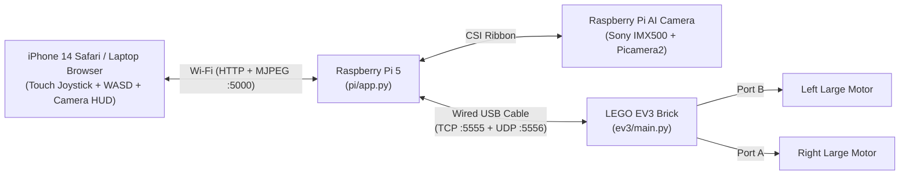
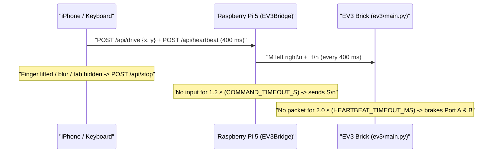

# Drone Boat Technical Documentation

Complete guide explaining **how the Drone Boat system works** under the hood and **how to set up and run it** on a **Raspberry Pi 5**, **Raspberry Pi AI Camera (IMX500)**, **LEGO MINDSTORMS EV3 Brick**, and **iPhone 14** (plus laptop keyboard control).

---

## 1. System Overview & Hardware Architecture

The Drone Boat uses a two-computer onboard architecture paired with a wireless mobile/desktop cockpit:

- **iPhone 14 (Safari) / Laptop Browser**: Displays the live camera HUD and sends steering, photo, video, and AI commands over Wi-Fi.
- **Raspberry Pi 5 (`pi/`)**: Hosts the HTTP web server (`pi/app.py`), captures video and on-chip AI inference from the **Raspberry Pi AI Camera**, saves photos/videos locally, and forwards motor commands to the EV3 over a wired USB cable.
- **LEGO EV3 Brick (`ev3/main.py`)**: Runs Pybricks MicroPython on ev3dev Linux, drives the two Large Motors (**Port A = Right wheel/propeller**, **Port B = Left wheel/propeller**), stays silent (single startup beep only), and acts as an independent safety watchdog.



### Project File Layout

```text
drone_boat/
├── DOCUMENTATION.md          # This technical & run guide
├── README.md                 # Quick-start summary
├── .gitignore
├── ev3/
│   └── main.py               # Silent Pybricks MicroPython TCP + UDP discovery motor server
└── pi/
    ├── requirements.txt      # Apt package list + optional desktop mock deps
    ├── config.py             # Environment-configurable ports, speed, camera & AI settings
    ├── ev3_bridge.py         # Differential tank mixer, UDP discovery, TCP client & watchdog
    ├── camera_manager.py     # Picamera2 + IMX500 AI detection, MJPEG, photo/video & mock cam
    ├── app.py                # Stdlib ThreadingHTTPServer, API endpoints & HTTP 206 media server
    ├── media/                # Created automatically at runtime (photos/*.jpg, videos/*.mp4)
    └── static/
        ├── index.html        # Full-screen iPhone 14 cockpit layout
        ├── style.css         # Glassmorphic HUD, safe-area insets & touch-action rules
        └── controller.js     # Pointer joystick, WASD keyboard, gallery & status polling
```

---

## 2. How It Works

### 2.1 Differential Tank Steering (`ev3_bridge.py` & `ev3/main.py`)

Both the iPhone touch joystick and keyboard `W`/`A`/`S`/`D` keys produce normalized steering coordinates `(x, y)` where:
- `x` in `[-1.0, +1.0]`: turn left (`-1`) to turn right (`+1`)
- `y` in `[-1.0, +1.0]`: reverse (`-1`) to forward (`+1`)

1. **`mix_joystick(x, y, max_speed=900, deadzone=0.08)`** in [ev3_bridge.py](file:///C:/dev/ws2/drone_boat/pi/ev3_bridge.py):
   - Clamps `x` and `y` to `[-1.0, 1.0]`.
   - If `hypot(x, y) < 0.08`, returns `(0, 0)` so resting jitter never nudges the motors.
   - Computes differential thrust:
     - `raw_left = y + x`
     - `raw_right = y - x`
   - Normalizes by `scale = max(1.0, abs(raw_left), abs(raw_right))` so diagonal steering stays proportional instead of clipping early, then scales to `MAX_SPEED` (`900` deg/s):
     - Full forward (`x=0, y=1`) -> `(+900, +900)`
     - Full reverse (`x=0, y=-1`) -> `(-900, -900)`
     - Spin right (`x=1, y=0`) -> `(+900, -900)`
     - Spin left (`x=-1, y=0`) -> `(-900, +900)`
2. **`EV3Bridge.set_motors(left, right)`** clamps speeds to `[-MAX_SPEED, +MAX_SPEED]` and immediately sends `M <left> <right>\n` (or `S\n` when `(0, 0)`) over a `TCP_NODELAY` socket to the EV3.
3. **`ev3/main.py`** maps **`Port.B`** to `left_motor` and **`Port.A`** to `right_motor`. It buffers incoming bytes by `\n`, applies only the latest movement/stop command in each TCP read chunk, and calls `.run(speed)` or `.brake()`.
4. The EV3 brick stays **silent** during driving (only emitting one short `ev3.speaker.beep()` at startup).

### 2.2 Wired USB Link & Automatic EV3 Discovery

Plugging the EV3 into a Raspberry Pi 5 USB-A port creates a wired USB-Ethernet network interface (`usb0` on Pi / `usb0` on ev3dev).

- **Startup IP display**: `ev3/main.py` reads Linux `/proc/net/fib_trie` (`get_local_ips()`) and displays `"Boat EV3 Ready"`, up to two non-loopback IPv4 addresses, and `"Port: 5555"` on the EV3 LCD.
- **Zero-config discovery**: `EV3Bridge` first tries `EV3_HOST:EV3_PORT` (default `ev3dev.local:5555`). If mDNS fails or the IP changed, `discover_ev3_udp()` broadcasts `EV3_BOAT_DISCOVER` on UDP port `5556` across all local interfaces (including `169.254.255.255` and `255.255.255.255`). The EV3 replies `EV3_BOAT_HERE:5555`, and the Pi connects automatically—retrying every `1.5 s` if the EV3 reboots or the USB cable is replugged.

### 2.3 Three-Layer Runaway Safety Failsafe

A drone boat on water must stop immediately if signal is lost:



1. **Client layer ([controller.js](file:///C:/dev/ws2/drone_boat/pi/static/controller.js))**: Sends `POST /api/stop` on pointer release, `pointercancel`, window `blur`, `visibilitychange`, opening the gallery, or pressing `Space`/`Esc`. While holding the joystick off-center, it sends `POST /api/heartbeat` every `400 ms`.
2. **Pi 5 layer ([ev3_bridge.py](file:///C:/dev/ws2/drone_boat/pi/ev3_bridge.py))**: Background watchdog thread checks every `50 ms`; if `time.monotonic() - last_input_ts > COMMAND_TIMEOUT_S` (`1.2 s`), it resets target speeds to `(0, 0)` and sends `S\n` to the EV3.
3. **EV3 layer ([ev3/main.py](file:///C:/dev/ws2/drone_boat/ev3/main.py))**: Polls the TCP client with `HEARTBEAT_TIMEOUT_MS = 2000`. If Wi-Fi drops, the Pi crashes, or the USB cable is unplugged, the EV3 immediately runs `stop_motors()` (`brake()`) and waits cleanly for reconnection.

### 2.4 AI Camera Pipeline, MJPEG Stream & Media Capture (`camera_manager.py`)

[camera_manager.py](file:///C:/dev/ws2/drone_boat/pi/camera_manager.py) runs a background capture loop (`_capture_loop`) at `CAM_FPS` (`25 fps` at `960x540` by default):

1. **On-chip AI inference (`IMX500`)**:
   - Loads `AI_MODEL_PATH` (`/usr/share/imx500-models/imx500_network_ssd_mobilenetv2_fpnlite_320x320_pp.rpk`) onto the IMX500 sensor if present.
   - Captures synchronized frames and neural network metadata using `picam2.capture_request()`, parses `boxes, scores, classes` via `imx500.get_outputs(metadata, add_batch=True)`, maps bounding boxes with `imx500.convert_inference_coords(...)`, and filters by `AI_THRESHOLD` (`0.5`).
   - When `AI` is toggled **ON**, draws bounding boxes and confidence labels directly onto the frame using OpenCV (`cv2`). Toggling **OFF** disables the overlay in real time without restarting the camera.
2. **Live MJPEG stream**:
   - Encodes each frame to JPEG (`JPEG_QUALITY = 80`) and notifies all open `/video_feed` viewers through a `threading.Condition`.
3. **Non-interrupting Photo & Video capture**:
   - **Photo (`capture_photo()`)**: Writes the latest JPEG bytes to `pi/media/photos/photo_YYYYMMDD_HHMMSS.jpg`.
   - **Video (`start_recording()` / `stop_recording()`)**: Streams frames to an encoder in parallel while the live view continues uninterrupted:
     - **Priority 1 (`ffmpeg`)**: Pipes `bgr24` frames to `ffmpeg` (`libx264`, `-preset ultrafast`, `-tune zerolatency`, `-pix_fmt yuv420p`, `-movflags +faststart`) producing **iPhone Safari-compatible `.mp4`** files in `pi/media/videos/`.
     - **Priority 2 (`cv2.VideoWriter`)**: Falls back to `avc1` / `mp4v` `.mp4` if `ffmpeg` is not installed.
     - **Priority 3 (`_MjpegRecorder`)**: Falls back to `.mjpg` if neither `ffmpeg` nor OpenCV is present.
4. **Mock Mode (`MOCK_MODE=1`)**:
   - Automatically used when `MOCK_MODE=1` is set (or if `picamera2` is unavailable). Renders an animated twilight ocean scene with moving `buoy` and `boat` AI detection overlays via OpenCV or Pillow.

### 2.5 Web Server & HTTP API (`app.py`)

[app.py](file:///C:/dev/ws2/drone_boat/pi/app.py) uses Python's standard-library `ThreadingHTTPServer` (no Flask or external pip packages required):

| Method & Path | Purpose |
| :--- | :--- |
| `GET /` | Serves `pi/static/index.html` |
| `GET /static/<file>` | Serves `style.css`, `controller.js` |
| `GET /video_feed` | Multipart MJPEG live camera stream (`multipart/x-mixed-replace`) |
| `GET /api/status` | Returns EV3 status, motor speeds, AI state, recording state/timer, and media count |
| `POST /api/drive` | Accepts `{"x": float, "y": float}` or `{"left": int, "right": int}` |
| `POST /api/stop` | Immediately brakes both EV3 motors |
| `POST /api/heartbeat` | Refreshes Pi-side `1.2 s` watchdog timer |
| `POST /api/ai` | Sets `{"enabled": bool}` or toggles AI overlay if body is empty |
| `POST /api/photo` | Saves JPEG snapshot and returns item metadata (`201`) |
| `POST /api/video/start` | Starts recording video alongside live stream |
| `POST /api/video/stop` | Finalizes and saves video, returning item metadata |
| `GET /api/media` | Lists saved photos and videos newest-first |
| `GET /media/<photos\|videos>/<name>` | Serves media with HTTP `Range` (`206 Partial Content` for Safari `<video>`); append `?download=1` for attachment download |
| `DELETE /api/media/<photos\|videos>/<name>` | Deletes saved photo/video (`409` if actively recording) |

### 2.6 Interactive Cockpit UI (`pi/static/`)

- **Touch Joystick**: Uses Pointer Events (`setPointerCapture`) with `touch-action: none` so dragging steers smoothly without scrolling or zooming Safari.
- **Keyboard Controls** (also visually mirrors onto the joystick knob):
  - Hold **`W` / `S` / `A` / `D`**: Forward / Reverse / Turn Left / Turn Right
  - **`Space`**: Emergency stop
  - **`P`**: Take photo (triggers shutter flash + clickable toast)
  - **`V`**: Start / stop video recording
  - **`I`**: Toggle AI object detection
  - **`G`**: Open / close media gallery (`Esc` closes preview/gallery or stops boat)

---

## 3. How to Run It

### Option A: Quick Demo on Your Windows Laptop (`MOCK_MODE=1`)

Test the full web cockpit, joystick, keyboard controls, simulated AI camera, photo/video capture, and gallery locally without Raspberry Pi or EV3 hardware:

```powershell
cd C:\dev\ws2\drone_boat
$env:MOCK_MODE = "1"
C:\dev\ws2\.venv\Scripts\python.exe pi\app.py
```

1. Open **`http://localhost:5000`** on your laptop browser.
2. To preview on your **iPhone 14** on the same Wi-Fi, open **`http://<your-laptop-ip>:5000`** in Safari (allow Python through Windows Firewall if prompted).

---

### Option B: Full Boat Deployment (EV3 + Raspberry Pi 5 + iPhone 14)

#### Step 1: Hardware Wiring & Power
1. Connect **Right Large Motor** -> EV3 **Port A**, **Left Large Motor** -> EV3 **Port B**.
2. Connect the **Raspberry Pi AI Camera** to a CSI camera port on the Raspberry Pi 5.
3. Connect the **EV3 Brick** (mini-USB port on top) to any **USB-A port** on the Raspberry Pi 5.
4. Use **separate power** inside a waterproof hull:
   - Raspberry Pi 5: 5V/5A USB-C power bank or 5V BEC.
   - EV3 Brick: EV3 rechargeable battery pack or 6x AA batteries.

#### Step 2: Prepare & Start the EV3 Brick (`ev3/main.py`)
1. Copy [ev3/main.py](file:///C:/dev/ws2/drone_boat/ev3/main.py) onto your EV3 (`/home/robot/drone_boat/main.py`) via VS Code (`ev3devBrowser` -> `Download and Run`) or `scp`.
2. On the EV3 Brickman menu, verify USB networking is active (**Wireless and Networks -> All Network Connections -> Wired** / **Tethering**).
3. Run `main.py` on the EV3. Wait for the single startup beep and `"Boat EV3 Ready"` on the EV3 LCD.
   - *Direction check*: Bench-test first before putting the boat in water. If forward steering spins the motors backward, change `MOTOR_DIRECTION = Direction.CLOCKWISE` to `Direction.COUNTERCLOCKWISE` in [ev3/main.py](file:///C:/dev/ws2/drone_boat/ev3/main.py#L25).

#### Step 3: Install Packages & Start the Raspberry Pi 5 (`pi/`)
1. On Raspberry Pi OS (Bookworm or newer), install system packages via `apt` (no `pip install` required):
   ```bash
   sudo apt update
   sudo apt install -y python3-picamera2 python3-opencv imx500-all ffmpeg
   sudo reboot
   ```
2. Copy the `pi/` folder onto your Raspberry Pi 5 (for example `/home/pi/drone_boat/pi`).
3. Start the server:
   ```bash
   cd ~/drone_boat/pi
   python3 app.py
   ```
   The terminal prints the URL (for example `http://192.168.1.50:5000` or `http://10.42.0.1:5000`).

#### Step 4: Outdoor Wi-Fi Hotspot + iPhone 14 Cockpit
When piloting outdoors away from a router, turn the Raspberry Pi 5 into its own Wi-Fi access point:

```bash
sudo nmcli device wifi hotspot ifname wlan0 ssid DroneBoat password "droneboat"
```

1. On **iPhone 14**, open **Settings -> Wi-Fi** and join **`DroneBoat`**.
2. Open **Safari** and go to **`http://10.42.0.1:5000`**.
3. Tap **Share -> Add to Home Screen** to launch it as a full-screen cockpit app without Safari address bars.

#### Optional: Auto-Start on Raspberry Pi 5 Boot
Create `/etc/systemd/system/drone-boat.service` on the Pi 5 (adjust `User` and paths if your username is not `pi`):

```ini
[Unit]
Description=Drone Boat Cockpit Server
After=network-online.target
Wants=network-online.target

[Service]
Type=simple
User=pi
WorkingDirectory=/home/pi/drone_boat/pi
ExecStart=/usr/bin/python3 /home/pi/drone_boat/pi/app.py
Restart=always
RestartSec=3

[Install]
WantedBy=multi-user.target
```

Enable and start it:
```bash
sudo systemctl daemon-reload
sudo systemctl enable --now drone-boat
```

---

## 4. Configuration Reference (`pi/config.py`)

All Raspberry Pi settings can be overridden via environment variables before running `python3 app.py`:

| Environment Variable | Default | Description |
| :--- | :--- | :--- |
| `WEB_HOST` | `0.0.0.0` | HTTP bind interface |
| `WEB_PORT` | `5000` | HTTP web cockpit port |
| `EV3_HOST` | `ev3dev.local` | Primary EV3 hostname or IP (falls back to UDP discovery) |
| `EV3_PORT` | `5555` | EV3 TCP motor control port |
| `EV3_DISCOVERY_PORT` | `5556` | UDP broadcast discovery port |
| `MAX_SPEED` | `900` | Maximum EV3 motor speed (`deg/s`) |
| `COMMAND_TIMEOUT_S` | `1.2` | Pi-side watchdog stop timeout (`seconds`) |
| `CAM_WIDTH` | `960` | Stream and video frame width (`px`) |
| `CAM_HEIGHT` | `540` | Stream and video frame height (`px`) |
| `CAM_FPS` | `25` | Target camera capture frame rate |
| `JPEG_QUALITY` | `80` | MJPEG / photo JPEG quality (`1–100`) |
| `AI_MODEL_PATH` | `/usr/share/imx500-models/imx500_network_ssd_mobilenetv2_fpnlite_320x320_pp.rpk` | IMX500 `.rpk` model file |
| `AI_THRESHOLD` | `0.5` | Minimum detection confidence (`0.0–1.0`) |
| `AI_ENABLED` | `1` | Start with AI overlay enabled (`1` or `0`) |
| `MOCK_MODE` | `0` | Simulate camera and EV3 without hardware (`1` or `0`) |

---

## 5. Troubleshooting

- **Top-left status shows `NO EV3` (red dot):**
  - Confirm [ev3/main.py](file:///C:/dev/ws2/drone_boat/ev3/main.py) is running on the EV3 (`Boat EV3 Ready` on screen) and the USB cable is plugged into the EV3's mini-USB port and Pi 5 USB-A port.
  - Check the IP shown on the EV3 screen and start the server with `EV3_HOST=<ev3-ip> python3 app.py`.
- **Boat moves backward or turns opposite to joystick:**
  - Flip `MOTOR_DIRECTION` in [ev3/main.py](file:///C:/dev/ws2/drone_boat/ev3/main.py#L25) to `Direction.COUNTERCLOCKWISE`, or swap the motor plugs between **Port A** (right) and **Port B** (left).
- **Camera runs in simulated mode on Raspberry Pi 5:**
  - Verify `python3-picamera2` and `imx500-all` are installed (`sudo apt install -y python3-picamera2 python3-opencv imx500-all`), check the CSI ribbon orientation, and confirm `rpicam-hello` works.
- **Recorded video won't play inline in iPhone Safari:**
  - Ensure `ffmpeg` is installed on the Pi (`sudo apt install -y ffmpeg`). Without `ffmpeg`, OpenCV's `mp4v` fallback or `.mjpg` fallback may only download rather than play inline in iOS Safari.
- **Motors stop briefly while driving slowly:**
  - Make sure you don't have two browser tabs open against the same boat, and keep Wi-Fi within line-of-sight range so `/api/heartbeat` (`400 ms`) reaches the Pi before the `1.2 s` watchdog triggers.
